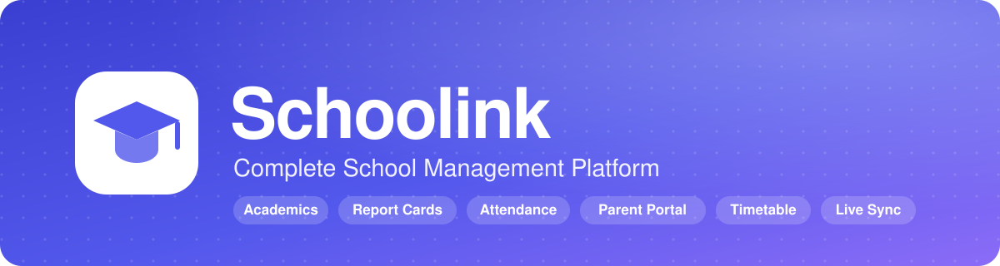
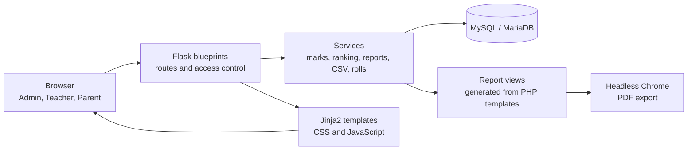

<p align="center">
  
</p>

<p align="center">
  <b>A complete, role-based school management platform built with Flask.</b><br>
  Academics, marks, attendance, report cards, timetable, parent portal and live updates in one clean interface.
</p>

<p align="center">
      
</p>

<p align="center">
  <a href="#-features">Features</a> &bull;
  <a href="#-tech-stack">Tech stack</a> &bull;
  <a href="#-architecture">Architecture</a> &bull;
  <a href="#-getting-started">Getting started</a> &bull;
  <a href="#-roles--access">Roles</a> &bull;
  <a href="#-project-structure">Structure</a>
</p>

---

## 📖 About

**Schoolink** is a school management platform that covers academics, marks and ranking, attendance, report cards,
timetable, events, announcements, leave requests and a parent portal. It is a complete rewrite of a legacy CodeIgniter
panel: same database structure, same calculations and same printed report designs, now with a responsive UI,
role based menus and real-time updates.

## ✨ Features

<table>
  <tr>
    <td width="50%" valign="top">
      <h3>🎓 Academics</h3>
      <ul>
        <li>Marks entry and special subjects</li>
        <li>Marks list, rank, average and awards</li>
        <li>Development skills, comments and house points</li>
        <li>Database driven report card layouts and rules</li>
      </ul>
    </td>
    <td width="50%" valign="top">
      <h3>🧾 Reports &amp; printing</h3>
      <ul>
        <li>Report cards on A4</li>
        <li>Tabulation and weighted sheets on 23 x 35 in</li>
        <li>One click PDF export</li>
        <li>Multiple designs per class and stream</li>
      </ul>
    </td>
  </tr>
  <tr>
    <td width="50%" valign="top">
      <h3>👩‍🏫 Teachers &amp; students</h3>
      <ul>
        <li>Subject teacher and class teacher panels</li>
        <li>Teacher mapping by class, section and subject</li>
        <li>Automatic roll numbers (1...N per section)</li>
        <li>Transfer log for every class or stream change</li>
      </ul>
    </td>
    <td width="50%" valign="top">
      <h3>👨‍👩‍👧 Parent portal</h3>
      <ul>
        <li>Child profile, attendance and report card</li>
        <li>Timetable, events, work and announcements</li>
        <li>Photo gallery and leave requests</li>
        <li>Parent accounts linked to children</li>
      </ul>
    </td>
  </tr>
  <tr>
    <td width="50%" valign="top">
      <h3>⚡ Productivity</h3>
      <ul>
        <li>CSV import and export for bulk data</li>
        <li>Global search</li>
        <li>Real-time sync across open sessions</li>
        <li>Media library with upload popup</li>
      </ul>
    </td>
    <td width="50%" valign="top">
      <h3>🎨 Experience</h3>
      <ul>
        <li>Fully responsive interface</li>
        <li>Light and dark theme</li>
        <li>Collapsible sidebar and role based menus</li>
        <li>Toasts, dialogs and smart dropdowns</li>
      </ul>
    </td>
  </tr>
</table>

## 🧰 Tech stack

| Layer | Technology |
|:--|:--|
| **Language** | Python 3 |
| **Web framework** | Flask 3 with blueprints and Jinja2 templates |
| **Database** | MySQL / MariaDB through PyMySQL |
| **Security** | bcrypt password hashing, signed sessions, role based access control |
| **Images** | Pillow |
| **Documents** | python-docx |
| **PDF export** | Headless Google Chrome |
| **Frontend** | HTML5, custom CSS design system, vanilla JavaScript |
| **Typography** | DM Sans and Plus Jakarta Sans (Google Fonts) |
| **Tooling** | Custom PHP to Python template transpiler (`tools/php2py.py`) |

## 🏗 Architecture



## 🚀 Getting started

**Requirements:** Python 3.10+, MySQL or MariaDB, Google Chrome (only for PDF export).

```bash
git clone https://github.com/saha3112/schoolink.git
cd schoolink

python3 -m venv .venv
.venv/bin/pip install -r requirements.txt

mkdir -p .secrets && cp .env.example .secrets/.env   # fill in your values
.venv/bin/python run.py     # http://127.0.0.1:8120
```

### Configuration

Settings come from environment variables or an `.env` file, read from `$SCHOOLINK_ENV`, then `.secrets/.env`, then `./.env`.

| Variable | Description |
|:--|:--|
| `SECRET_KEY` | Flask session secret |
| `DB_HOST`, `DB_PORT` | Database server |
| `DB_USER`, `DB_PASSWORD`, `DB_NAME` | Database credentials |
| `SCHOOL_NAME`, `SCHOOL_TAGLINE` | Fallback branding (editable later in Settings) |
| `CHROME_BIN` | Path to Google Chrome for PDF export |
| `HOST`, `PORT`, `DEBUG` | Server options |

## 🔐 Roles & access

| Role | Access |
|:--|:--|
| **Admin / Super admin** | Masters, mappings, exams, students, reports, users and settings |
| **Subject teacher** | Marks Entry, Special Subjects, Marks List |
| **Class teacher** | Attendance, Comments, Development Skills, Rank, House Points, Average and Award, Tabulation, Weighted sheet and Report Cards of their own section |
| **Parent** | Parent portal for linked children |
| **Others** | Change Password only |

Every signed-in user can change their own password from the profile menu. Admins can reset any user's password.

## 🔄 What changed from the old app

- **Teacher mapping** is one row per teacher. Manage exact class, section and subject rows, in bulk.
- **Merged pages.** Duplicated pages (bulk entry, master entry, list variants, three rank pages) are now one page per task.
- **Roll numbers** stay 1...N per section. When a student leaves or moves, gaps close automatically and each change is logged in `student_transfer_log`.
- **Print sizes.** Tabulation and weighted sheets export on 23 x 35 inch landscape, report cards on A4.

## ⚙️ Report card engine

`app/services/reportdata.py` and `app/services/reportcard.py` are line by line ports of the original PHP calculations.
The original report templates are converted with `tools/php2py.py`, so printed designs keep identical markup:

```bash
tools/build_views.sh /path/to/old/application/views
```

## 📁 Project structure

```text
schoolink/
├── app/
│   ├── blueprints/    routes: marks, students, reports, parents, media, live ...
│   ├── services/      business logic: report data, ranking, CSV, PDF, rolls ...
│   ├── templates/     Jinja2 templates
│   ├── static/        CSS, JavaScript, images
│   └── views_py/      generated report templates (do not edit by hand)
├── docs/              banner and documentation assets
├── tests/             automated tests
├── tools/             php2py transpiler and helper scripts
├── config.py          configuration
└── run.py             application entry point
```

## 🧪 Tests

```bash
.venv/bin/python -m pytest tests
```

---

<p align="center">Built for schools that want clear, fast and reliable report cards.</p>
